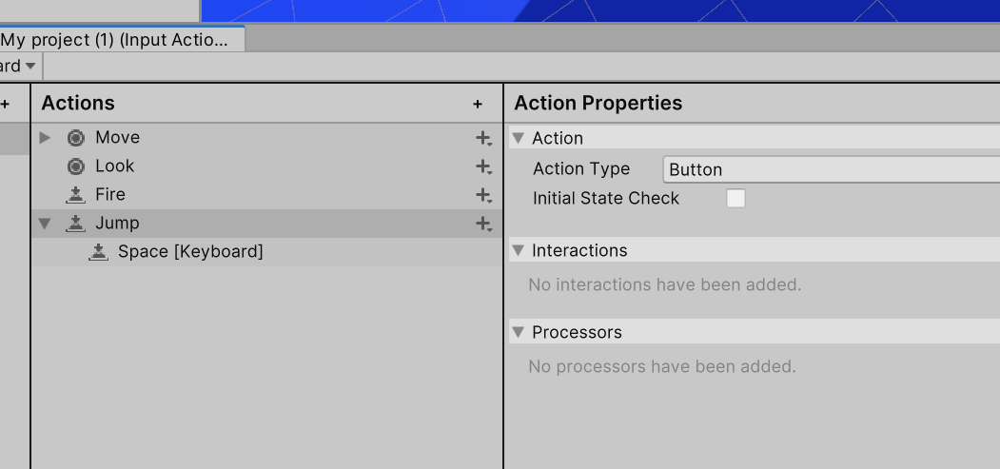

# Laboratorium \#2

## Git/Github

* Konfiguracja git/githuba. Unity gitigonre https://github.com/github/gitignore/blob/main/Unity.gitignore 

## Probuilder

- Podstawy modelowania 3D za pomocą Probuildera
  [probuilder.md](probuilder.md)

## Ścieżka programistyczna

Probuilder a kodowanie

https://docs.unity3d.com/Packages/com.unity.probuilder@6.0/manual/api.html

[probuilder-kodowanie.md](probuilder-kodowanie.md)

## Ćwiczenia podsumowujące

- Stwórz scenę (może być nowy projekt lub dotychczasowy) w którym
  stworzyć model fragmentu rzeczywistości.
- Dodanie gracza (kulka lub kostka) z prostym skryptem poruszania.

Pomocnicze skrypty: [PlayerController.cs](PlayerController.cs)
[CameraController.cs](CameraController.cs)

Dodanie inputa do skoku:

- Opcjonalnie można uzupełnić obiekty teksturami (po rozpakowaniu pliku
  wystarczy przeciągnąć i upuścić na katalog Assets).

Bezpłatne tekstuty można znaleźć np. tutaj:
<https://itch.io/game-assets/free/tag-textures>

Wybrane tutoriale:

- https://www.youtube.com/watch?v=YtzIXCKr8Wo
- https://www.youtube.com/watch?v=cOSxvvnGnuM&list=PLs_yJ-RML1YeM2KbHbVKh50CkwINm-biV
- https://www.youtube.com/watch?v=ElNfaUFpqmc&list=PLuVz-FGt23yLxDo1bjaFoslJoS3Ds5Iw

## VR - proste sample + konfiguracja projektu

Baza: https://developers.meta.com/vr/documentation/unity/unity-tutorial-hello-vr/

Czynności do wykonania:

Przy pracy z projektami z okularami - warto stworzyć jeden projekt na wszystkie kolejne ćwiczenia. Dalsze ćwiczenia - nowe sceny i właściwe porządkowanie assetów.

- dodanie pakietów Meta XR Core SDK (`com.meta.xr.sdk.core`) oraz Meta XR Interaction ​SDK (`com.meta.xr.sdk.interaction.ovr`)
- włączenia obsługi OpenXR w ustawienia projektu
- w Build Profiles włączenie platofrmy Meta Quest i przełączenie się na nią
- w okularach w ustawieniach musi być włączone debugowanie USB (jeśli nie jest aktywne, należy zgłosić prowadzącemu w celu aktywacji)
- przegląd sampli z pierwszego pakietu
